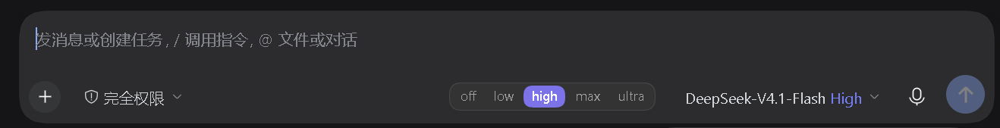

# dsh-clarify-tier

> 给 DeepSeek Harness 的输入框加一条 **需求锚定档位** 分段条：`off / low / high / max / ultra`。
> 用户选档，模型通过 `clarify_tier` 工具读到，据此决定"开工前问多深"。



## 它解决什么

模型接任务时的"问多深"通常靠临场判断：琐事被追问三轮，重活却只确认一句。
这个控件把档位从隐形变成显式——拨到哪档，这一轮就按哪档的流程走。

## 五档

| 档 | 名词 | 锁定的东西 | 悬停提示 |
|---|---|---|---|
| **off** | 静默 | 不介入 | 静默：不走本技能 |
| **low** | 方向 | 做什么、动哪里 | 方向：做什么、动哪里 |
| **high**（默认） | 约束 | 目标与禁区 | 约束：目标与禁区 |
| **max** | 落地 | 步骤、回滚、验收 | 落地：步骤、回滚、验收 |
| **ultra** | 拷问 | 假设 | 拷问：没有默认假设 |

配套技能 `clarify-needs`（需求锚定流程）在 [token-governance](https://github.com/YokosWY/token-governance) 仓库。

## 安装

需要：DSH Desktop / DSH NEXT（带 Web 客户端插件支持的版本）。

```powershell
# DSH_HOME 已设置时（桌面版默认就有）
pwsh -File install-profile.ps1             # 装进 desktop profile
pwsh -File install-profile.ps1 -Uninstall  # 卸载

# 没设置 DSH_HOME 时显式指定
pwsh -File install-profile.ps1 -DshHome "C:\Users\<you>\.dsh"
```

脚本做三件事：往 profile 的 `package.json` 加一条 `link:` 依赖、把包名追加进 `dsh.profile.bundles`、
在 profile 的 `node_modules` 下建链接。装完**完全退出并重开** DSH（关窗口不够，要退出进程）。

验证：输入框工具行、模型选择左边出现五格分段条；点一档后问模型「档位多少」，它应能调 `clarify_tier` 报出同值。

## 工作原理

| 层 | 文件 | 职责 |
|---|---|---|
| 客户端 | `lib/client.js` | 分段条 UI，注册进 `conversation.input.right` 插槽（`order=10`，落在模型席左边） |
| 宿主 | `lib/index.js` | 落盘状态、开本地桥、注册 `clarify_tier` 工具 |
| 形态 | `cordis.patch.yml` + `package.json` 的 `dsh.client` | 进 cordis 树，客户端产物才会被编进启动包 |

- 桥：`http://127.0.0.1:43871/state`（GET/POST，只绑回环，CORS `*`，端口可用 `DSH_CLARIFY_TIER_PORT` 改）
- 状态：`$DSH_HOME/storages/clarify-tier.json`
- 模型可见通道：工具 `clarify_tier`（读当前值；不写）

三条纪律：**fail-open**（注册失败只是控件不出现）、**不碰官方 DOM**、**不注入会话消息**。

## 已知边界

- 档位是**全局**的，不是每会话一份（v0.1 的取舍）
- 桥接端口被占时，控件退化为只读（虚线边框 + `!`），不刷屏报错
- `clarify_tier` 返回的是调用时刻的值；中途改档要再调一次

## 踩过的坑（别重犯）

| 坑 | 症状 | 正解 |
|---|---|---|
| 客户端 bundle 的 `id` 写成短名 | `duplicate factory registration` → `web boot: 1 entry did not activate` → 整个 GUI 起不来 | `id` 必须等于包名本身（含 `@scope`） |
| 宿主没声明 `inject` | `cannot get property "tools" without inject`，工具静默消失 | `export const inject = ["tools"]` |

## 卸载

1. `install-profile.ps1 -Uninstall`
2. 删 `$DSH_HOME/storages/clarify-tier.json`
3. 重开应用

## License

MIT
