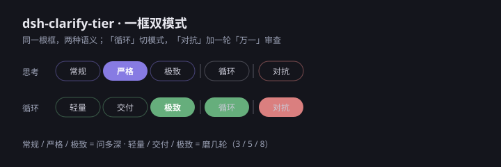

# dsh-clarify-tier

[](https://github.com/YokosWY/dsh-clarify-tier/releases)
[](LICENSE)
[](#安装)
[](package.json)

> 给 DSH 输入框加**一根框、两个模式**的档位条：
> `常规 | 严格 | 极致 ‖ 循环`（思考）↔ `轻量 | 交付 | 极致 ‖ 循环`（循环）。
> 拨档 → 模型通过 `clarify_tier` / `forge_level` 读到 → 决定开工问多深、交付后磨几轮。



## 同框双模式

```
思考：  [常规] [严格] [极致] ‖ [循环]        ← 紫
循环：  [轻量] [交付] [极致] ‖ [循环]亮     ← 琥珀
```

右侧「循环」用一条隔离线隔开，它是**模式开关**，不是第四档。
切到循环模式后，前三个格的含义从「问多深」变成「磨几轮」，标签和配色一起换。

| 模式 | 格 | 含义 | 模型读到 |
|---|---|---|---|
| 思考 | 常规（值 `off`） | 按平时标准直接做：不锚定、不复述、不提问 | `clarify_tier=off` |
| 思考 | 严格（默认） | 复述 + 2 确认点 + 回滚 + 验收 + 失败分支 | `clarify_tier=high` |
| 思考 | 极致 | 严格之上再加反例与代价、对抗自检、对抗复审 | `clarify_tier=max` |
| 循环 | 轻量 | 3 轮纯自检，适合小修小补 | `forge_level=lite` |
| 循环 | 交付 | 5 轮，第 2 轮独立评审 + 收敛复核 | `forge_level=high` |
| 循环 | 极致 | 8 轮，第 2 轮起每轮独立评审 | `forge_level=max` |

**为什么不叠两轴**：一根框放不下「问多深 × 磨几轮」四象限；循环模式下的轻量对齐交给 loop-forge 第 1 步的「定判据」，比再摆一条滑条更省。

## 状态模型（每个对话各用各的）

```json
{
  "schema": 6,
  "sessions": {
    "<sessionId>": { "mode": "think" | "loop", "level": "off" | "high" | "max", "updatedAt": "…" }
  }
}
```

- **会话键**：客户端用插槽 inject 给的 `sessionId`，经 `?session=` 传给桥；工具用 `exec.agent.session.id`，读不到才落 `default`
- `clarify_tier`：思考模式返回 `level`；循环模式返回 `off`（不叠加锚定）
- `forge_level`：思考模式返回 `off`；循环模式把 `off/high/max` 映射成 `lite/high/max` 与 3/5/8 轮
- **每轮快照**：一条用户消息 = 一轮（轮号取 `agent.phase.turn`）。开工第一次调工具时，把当时的档位记成本轮快照（`turn{id,mode,level}`）；本轮内再点档位条只改「下轮的值」，条尾显示一个琥珀小点（`pending`）
- 下一轮开工自动换用新值；取不到轮 id 时退回实时值（不做轮内保护，但功能不坏）
- 没单独设置过的对话，继承 `default` 会话（迁移自 0.6 的全局值），再没有就用内置 `think/high`
- 文件：`$DSH_HOME/storages/clarify-tier.json`；每会话只写自己那条，切模式不会丢档位；最多保留 100 个会话（删最旧的非 `default`）
- **实时同步**：`GET /events?session=…` 只推本会话；同一对话开两个窗口才互通，跨对话互不干扰；普通断线按 `retry: 2000` 自动重连，连接被彻底关掉（`readyState=2`）时客户端按 `CONFIG.reconnectDelay` 自己重建，最多 `CONFIG.maxReconnects` 次

## 安装

需要：DSH Desktop / DSH NEXT（带 Web 客户端插件支持的版本）。

```powershell
pwsh -File install-profile.ps1             # 装进 desktop profile
pwsh -File install-profile.ps1 -Uninstall  # 卸载
```

脚本做三件事：往 profile 的 `package.json` 加一条 `link:` 依赖、把包名追加进 `dsh.profile.bundles`、
在 profile 的 `node_modules` 下建链接。装完**完全退出并重开** DSH（关窗口不够，要退出进程）。

验证：输入框工具行、模型选择左边出现一条四格框，默认停在「严格」；点最右「循环」，前三格变「轻量 / 交付 / 极致」且转琥珀色。再问模型「现在什么档」，它应能调 `clarify_tier` / `forge_level` 报出同值。

## 工作原理

| 层 | 文件 | 职责 |
|---|---|---|
| 客户端 | `lib/client.js` | 四格框 + 模式切换，注册进 `conversation.input.right`（`order=10`）。**单文件 bundle**，模块加载器只吃一个 factory，不能拆 import |
| 宿主入口 | `lib/index.js` | 装配层：起桥 + 注册工具 + 把 dispose 挂到 `ctx.effect` |
| 宿主模块 | `lib/core.js` / `lib/state.js` / `lib/bridge.js` / `lib/tools.js` | 常量与文案表 / 状态读写与迁移 / 回环桥 HTTP+SSE / 两个只读工具与轮内快照 |
| 形态 | `cordis.patch.yml` + `package.json` 的 `dsh.client` | 进 cordis 树，客户端产物编进启动包 |

- 桥：`http://127.0.0.1:43871/state`（GET/POST）与 `/events`（SSE）；只绑回环，宿主在 `43871–43880` 里取第一个能绑的端口，客户端按同区间探测 `/state` 的 `plugin` 标记自动对齐，两套 DSH 同时开着也不打架
- **两套 DSH 同开时靠「会话归属」认桥**：`/state` 带 `knownSession`，只有**本实例的工具**为该会话落过盘才算认识（客户端写只标 `owner:"client"`，认领不到）——`plugin` 标记只能证明「是同一个插件」，分不出是哪个实例
- **认不准就不碰桥**：扫一遍端口后若「两套以上、且谁都不认识本会话」，客户端**不读不写任何桥、也不连 SSE**，只用本地值（本地值天生属于本应用），并显示 `!`；期间点击先记账，认准实例后补写一次。工具只在本轮的第一次调用时落盘，所以通常几秒内就会认准
- **只有一套在跑就直接认**：端口上只找到一个本插件实例时不存在「连错」的可能，不必等工具落盘
- **点一次档只发一个 POST**：宿主在 POST 响应里直接回带 `mode/level/pending/turnLocked`，客户端不再补 GET（老宿主不回 `pending` 才退回拉一次）
- **端口发现失败后 3 秒内不重扫**：一轮探空会记住时间，期间点击不再打 10 个 fetch；挂载时 pull 与 SSE 并发要端口，同一时刻只跑一轮发现
- 档名 / 悬停 / 轮次表只在宿主定义一次，客户端从 `/state` 的 `labels`、`titles` 读；离线兜底文案由测试锁死与宿主一致
- 三条纪律：**fail-open**（注册失败只是控件不出现）、**不碰官方 DOM**、**不注入会话消息**

## 安全边界

桥只绑 `127.0.0.1`，并且：

- **带 Origin 的请求只放行本机页面**（`127.0.0.1` / `localhost` / `::1`），其余返回 403，且不回显 `Access-Control-Allow-Origin`
- 无 Origin 的请求（curl、测试、本地脚本）照常放行
- **POST 必须是 `application/json`**，挡掉 `text/plain` 这类绕过预检的简单请求
- 没有 token 鉴权：**同机其它进程仍可写**。这台机器上的信任边界就是本机，够用但不防本机恶意程序

## 测试

```bash
npm test        # node --test，58 项，约 4 秒
npm run lint    # scripts/check.mjs：lib 下所有模块 + 所有测试逐个 node --check
npm run verify  # lint + test，本地 CI 就用这条
```

覆盖：状态默认值、模式/档位合并写、非法值 400、标量与坏 JSON 400、两种老 schema 迁移 + `.bak`、坏 JSON 与未知 schema 不覆写（含「未来 schema 带 tier/forge」也不降级）、字段坏只保留能认的一半、两个工具投影、跨站 Origin 403（读/写/预检/null/子域伪装）、本机 Origin 回显 204、`text/plain` 415、写盘失败 500、SSE 首帧与写入广播（两个订阅者收同一帧）、跨站 SSE 403、四格结构、两套标签、循环格亮起、只提交变化维度、focus 重新对齐、SSE 推送落本地与坏帧容错、`/state` 文案优先、兜底文案与宿主表逐字一致、琥珀样式与隔离线、端口被占时退让到下一个并带 `plugin` 标记、退让日志只报一次就绪且端口正确、`knownSession` 只对本实例有的会话为 true；另有**交互与容错** 9 项（桥不可达时只探一遍端口且 TTL 内不重扫、POST 带回 pending 时不再补 GET、老宿主缺 pending 时补一次 GET、SSE 彻底断开后重建且不超上限、诊断默认关、离线与待生效同显、POST 响应带 `turnLocked`、两套实例时按会话归属切端口、老宿主无 `knownSession` 时不额外扫端口）；再加 9 项**一致性守则**（版本号与 CHANGELOG 同条、`files` 清单里的文件都在、`lib` 下每个模块都被 `files` 覆盖、当前文案不再出现旧名「极限」、工具描述与宿主档位表同字、skill 状态表同字、**skill 的档位表与宿主 `LEVELS` 同一套**、README 已知边界不再回头写「全局/写死端口」、README 写的测试条数等于实际条数）。

CI：`.github/workflows/ci.yml`，推上去后在 Node 22 / 24 上跑 `npm run lint` + `npm test`。本地没有网络通道时以 `npm run verify` 为准。

## 工作方式（项目内约定）

**开放性作业先方案再动手**（2026-10-24 定）：新功能、方案设计、架构选型这类没定论的事，先把方案、取舍、代价摆出来讨论，敲定后再写代码；不要先实现再解释。已定论的修 bug、补测试、改文案不受此限。

## 配套技能

| 技能 | 位置 | 作用 |
|---|---|---|
| clarify-needs | `skill/clarify-needs/` | 拿到思考档后怎么问：复述 / 确认点 / 设计树 / 共识摘要 |
| counter-review | `skill/counter-review/` | 循环里怎么杠：六轴矩阵 → 攻击卡（触发条件/后果/检查方法）→ 三态收口；由 `forge_level.counter` 开关 |
| loop-forge | `D:\AI\Skills\mine\loop-forge`（junction 到技能目录） | 拿到循环档后怎么磨：判据 → 每轮报数 → 自动下一轮 → 自动止损 |

```powershell
cmd /c mklink /J "D:\AI\DSH-NEXT\skills\loop-forge" "D:\AI\Skills\mine\loop-forge"
cmd /c mklink /J "D:\AI\DSH-NEXT\skills\clarify-needs" "%CD%\skill\clarify-needs"
cmd /c mklink /J "D:\AI\DSH-NEXT\skills\counter-review" "%CD%\skill\counter-review"
```

## 数据安全

- **读不出来不覆写**：坏 JSON / 未知 schema（如未来的 `schema:6`）只返回默认值并标 `corrupt` / `unsupported`，原文件原样保留
- **迁移前留备份**：旧的 `{tier, forge}` 迁移时先写 `clarify-tier.json.bak`
- **原子写**：临时文件 + `rename`，避免写到一半断电留下半截 JSON
- **写失败不谎报**：磁盘不可写时 POST 返回 500（`error: write failed`），不返回 200

## 已知边界

- **端口区间全被占**（`43871–43880` 十个都绑不上，例如三套 DSH 同开）时，控件退化为只读（虚线边框 + `!`）：本地点击仍然换档，但**不会同步到宿主**，重启后按宿主里的值走
- `DSH_CLARIFY_TIER_PORT` 只改宿主**起点**，客户端按同区间探测、认 `plugin` 标记，两端不用手工对齐；要改区间宽度得同时改宿主与客户端的 `PORT_SPAN`
- **「会话归属」认桥的空窗**：刚开的对话还没被工具写过时，两边都可能回 `knownSession=false`，这段时间控件**只显示本地值**（不读另一套的档位）并带 `!`，点击只记账不落地；本轮的第一次 `clarify_tier` 落盘后（最长 5 秒一轮的轮询）自动认准、补写、连 SSE
- **面板显示的是「最后一次认准后」的值**：认准之前改的档，认准后以宿主值为准；要立刻用新档就在认准后再点一次
- **降级后不会自己变回来**：端口全占 / 宿主没起时，控件停在只读（`!`）；恢复靠下一次成功写入、切窗口，或 SSE 重建成功
- **SSE 重建有上限**（`CONFIG.maxReconnects`，默认 3 次、间隔 2 秒）：连不上就停手，不做无限重试；重建时会顺手作废端口缓存，宿主换了端口也能重新发现
- 状态文件只有一个（`storages/clarify-tier.json`）：并发写按「最后落盘为准」，没有跨进程锁
- 工具返回的是调用时刻的值；中途改档要再调一次
- 循环模式不叠加思考档：需要强提问就先退回思考模式
- 多窗口实时同步：SSE 推送，同一对话两窗同时改动以最后落盘为准；SSE 不可用时退回「切窗口重新对齐」
- 快照是**按轮**的：只影响「我这一轮用什么」，不改你拨出来的值；别的对话互不影响
- **诊断默认关**：启动时不再往宿主写 `clarify-tier-debug.jsonl`（那个文件不轮转，会一直长）。要抓注册链路时在控制台执行 `localStorage.setItem("dsh-tier-debug","1")` 再刷新，用完删掉这个键

## 踩过的坑（别重犯）

| 坑 | 症状 | 正解 |
|---|---|---|
| 客户端 bundle 的 `id` 写成短名 | `duplicate factory registration` → `web boot: 1 entry did not activate` → GUI 起不来 | `id` 必须等于包名（含 `@scope`） |
| 宿主没声明 `inject` | `cannot get property "tools" without inject`，工具静默消失 | `export const inject = ["tools"]` |
| 两个开关写同一文件不做合并 | 切档把另一轴冲掉 | `writeState` 读旧值再合并 |
| 把「读不到」当成「要重置」 | 一次 GET 就把用户设置冲成默认 | 坏文件/未知 schema 只读兜底，迁移才写盘 |

## 卸载

1. `install-profile.ps1 -Uninstall`
2. 删 `$DSH_HOME/storages/clarify-tier.json`
3. 重开应用

## License

MIT
